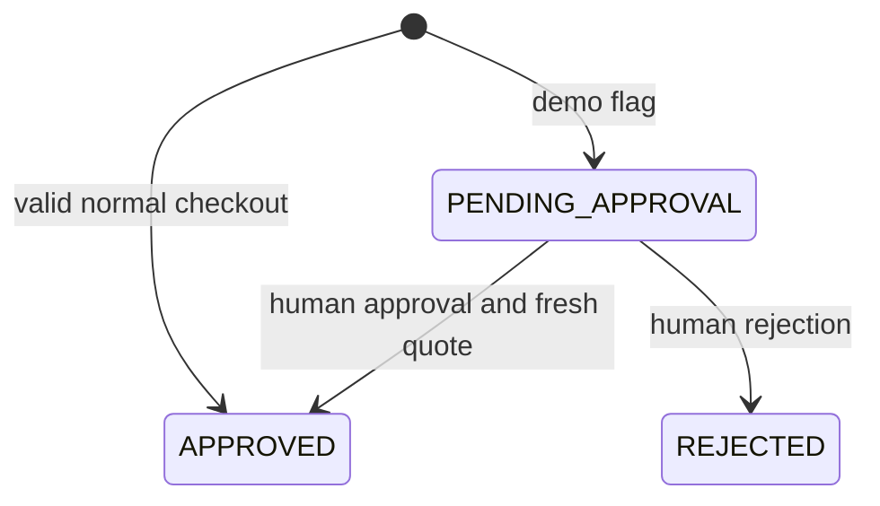

# Aimo agent approval demo

Node 22+ / Express monolith, PostgreSQL catalog and approval queue, and a local Node CLI with an Ollama adapter. Checkout is simulated locally: no real order is sent to Valio because the supplied OpenAPI contract has no checkout endpoint.

## Run

```sh
npm ci
cp .env.example .env
docker compose up -d db
npm run seed
npm start
```

In another terminal:

```sh
npm run cli -- agent --user-id customer-123 --preset normal-order
npm run cli -- agent --user-id customer-123 --preset suspicious-order
npm run cli -- approvals --user-id customer-123
```

The first preset is automatically `APPROVED`; the second is `PENDING_APPROVAL`. Enter `a` or `r` in the approval console, or use `approve ORDER_UUID` / `reject ORDER_UUID` with `--user-id`. `approvals --list-only` prints without prompting. Both presets select products `460000` and `460001` from the local catalog, with at least one sales unit rounded up to a valid lot size. In live mode these products might be unavailable; deterministic demos use `VALIO_MOCK=true`.

The workspace used during implementation has an ignored `.env` pointing to a temporary PostgreSQL instance at `127.0.0.1:55432`, database `aimo`, role `roni`. For a durable installation use the Compose volume and `.env.example` above. Source datasets are challenge-only, as stated in the supplied schema.

## Recipe agent

Run Ollama locally and pull the smaller default model with `ollama pull qwen2.5:3b`. Set `OLLAMA_MODEL=qwen2.5:3b` in your existing `.env` (copying a new `.env.example` is unnecessary), then:

```sh
npm run cli -- agent --user-id customer-123 --recipe "50 portions of creamy salmon soup" --date 2026-11-16
```

`OLLAMA_URL` and `OLLAMA_MODEL` select the local provider/model. The adapter first asks for ingredient search terms and alternative names/Finnish translations together, searches the static catalog with five candidates per ingredient, then asks the model to select IDs and quantities using the returned package/unit information. If an ingredient has no results, it tries up to three alternatives; an additional model call is needed only if the plan omitted alternatives. Only selected IDs are accepted. Missing search results after these retries, invalid model JSON, invalid quantities, or unavailable stock stop submission. Generated recipe carts always require approval; quantity conversion and ingredient suitability are not guaranteed by the model. Technical unit codes are not fully documented in the source data.

The CLI prints each stage and model-call durations. Requests use a JSON schema, request thinking off, and cap generation at 1,024 tokens; truncated responses fail explicitly. `OLLAMA_TIMEOUT_MS` controls the per-call timeout (default 180,000 ms). Run `ollama ps` while generating to check the `PROCESSOR` column: `100% CPU` means your GPU is not being used. An 8B reasoning model such as `deepseek-r1:8b` can be slow on CPU, and some reasoning models cannot disable thinking. For quick adapter checks without model inference or PostgreSQL, run `node --test test/agent.test.js`.

Repeated ingredient names are merged and catalog searches are cached within a recipe run. Before requesting a quote, the agent checks quantity limits, selected product IDs, duplicate product IDs, and lot sizes. An invalid cart gets one model correction attempt with validation feedback; a second failure stops with a readable error and no quote or order request. Quantities are never silently clamped or rounded. These checks do not establish recipe suitability or accurate portion-to-package conversion; human review is still required.

The CLI never receives the Valio API key or database credentials through the API. Its HTTP interface needs only `BACKEND_URL` and a customer ID. The model proposes structured data and cannot execute arbitrary tools. API identity comes from `X-User-Id` and is forwarded as Valio's `customer`.

## Live Valio mode

Set `VALIO_MOCK=false` and supply `VALIO_API_KEY` in `.env`, then restart the server. The default upstream is `https://junction26.valioaimo.fi`. The client sends JSON with `customer`, `requestedDate`, and `products` and authenticates with `X-API-Key`. Both wrappers enforce 1–1,000 distinct products, use a 15-second timeout, and surface upstream 429 responses without automatic retries. No catalog-wide price/stock refresh is performed. Mock mode must be explicitly enabled; it never silently substitutes for failed live calls. Mock quotes are visibly labeled and use EUR 2.50 per sales unit with synthetic stock.

## API contract

All endpoints except `/health` require `X-User-Id: CUSTOMER`. This is a **trusted localhost demo identity, not authentication**. The default listener is loopback. Before exposing this service, replace the header with authenticated identity and a separate human approver role; currently a caller who knows an ID can impersonate that user or approve their orders. The mock flagging rule is intentionally not a fraud detector or a rate-limit protection system.

| Method and path | Input / behavior |
| --- | --- |
| `GET /catalog/search` | Require `q`, `product_id`, or `category`. Optional `country`, `min_reliability`, `max_carbon`, `limit` (1–50). Returns products and a user-bound selection ID valid for 30 minutes. |
| `POST /api/price` | `{requestedDate, products, selection_ids}`; selected products only. Returns upstream fields plus `mocked`. |
| `POST /api/availability` | Same request shape and selection gate. |
| `POST /quotes` | Same request shape; fetches price and stock once each and persists a quote valid for 15 minutes. |
| `POST /orders` | Header `Idempotency-Key`; body `{quote_id, items:[{productId,quantity}], force_flag?:boolean}`. Uses only server-stored prices and catalog data. |
| `GET /orders` | Defaults to pending orders for this user. Supports `status`, `limit` (1–100), and `offset`. |
| `GET /orders/:id` | Retrieve this user's order. |
| `POST /orders/:id/approve` | Atomically approve a pending order with an unexpired quote. |
| `POST /orders/:id/reject` | Atomically reject a pending order. |

Example quote request after a catalog search:

```json
{
  "requestedDate": "2026-11-16",
  "products": ["460000"],
  "selection_ids": ["UUID-returned-by-catalog-search"]
}
```

Selections are persisted so an agent must narrow the catalog before a live call. Multiple searches can contribute to one quote. This gate does not prevent a malicious caller from repeatedly searching or querying; there is no production rate limiter in this demo.

`POST /orders` flags `force_flag=true`, header `X-Force-Flag: true`, more than 20 distinct order lines, or more than 20 total sales units. The latter is an intentionally simple demo threshold across heterogeneous units. Otherwise the order is approved immediately. Live queries themselves are not put into the order approval queue.



Pending means no simulated checkout completion. Approved means the monolith accepted the simulated order, not that Valio received or reserved it. Price/availability are quote snapshots rather than reservations. Approval checks quote freshness; expired pending orders can be rejected and a new quote submitted. Approval never reprices silently.

Idempotency is scoped by user and key. Concurrent retries of the same body return one order; different bodies with the same key return 409. CLI prints the exact body/key before submission for recovery. Re-running `agent` creates a new quote, so to retry a failed HTTP submission use that printed body and key directly. Concurrent opposite decisions allow only one transition. Repeating the same decision is idempotent. Order creation and decision events commit in the same transaction.

## Data and money

The actual supplied filenames are:

- `product_data.json`: 17,546 products; primary key is string `id`.
- `valio_aimo_junction26_product_data_schema.json`: source schema; quantities must be multiples of `allowedLotSize` in `salesUnit`.
- `valio_aimo_junction26_carbon_footprint.csv`: join `productId`, value `AVG kg CO2-eq/kg`; 11,033 catalog matches.
- `valio_aimo_junction26_delivery_reliability.csv`: join `productId`, value `deliveryReliability` (0–1); 4,425 matches.

`sql/schema.sql` defines catalog, selections, quotes, orders, and audit events. Seed uses one transaction with a database lock, batches upserts by product ID, and retains raw JSON for package/unit information. It can be rerun without duplicate products or affecting orders. Missing supplementary data remains null. Static searches use multilingual names and parameterized SQL; a simple substring scan is sufficient for this dataset. The seed updates/inserts supplied products; it does not delete records absent from later input files.

CO2 is **kg CO2-eq per kg of product**, not an order footprint. No total footprint is fabricated without reliable mass conversion. Reliability is a historical ratio, not guaranteed availability. Prices shown are per sales unit including tax. Line totals are rounded to cents and summed as integers; this demo does not calculate extra shipping or deposit charges. Blocked products, missing prices, insufficient quantities, passed cutoffs, wrong units, and delivery later than requested cannot be ordered.

## Verification

With PostgreSQL running and seeded:

```sh
npm test
```

Tests use real PostgreSQL and a temporary HTTP listener with mocked Valio responses. They cover joined data, selection enforcement, user scoping, quote expiry, lot sizes, payload tampering, idempotent concurrent submission, conflicting decisions, rejection, demo bulk flags, model adapter sequencing, upstream authentication, response failures, and API limits. Tests remove only their own generated data. Live Valio and an actual Ollama inference require the external services and are not part of the automated suite.

Source layout: `src/app.js` routes/search/quotes, `src/orders.js` checkout/state transitions, `src/valio.js` upstream adapter, `src/agent.js` local model adapter, `src/cli.js` agent and human interface, `scripts/seed.js` import.

## Standalone procurement workflow

The repository's ES-module Node stack is also used by the standalone procurement
module in `src/procurement/`. It does not use PostgreSQL or the demo mock switch.
Configure `VALIO_BASE_URL` and `VALIO_API_KEY`, then run:

```sh
node --env-file-if-exists=.env src/procurement/cli.js order.json
node --test test/procurement.test.js
```

Example order.json:

```json
{
  "customer": "customer-123",
  "requestedDate": "2026-11-16",
  "lines": [
    {
      "id": "milk",
      "quantity": 4,
      "salesUnit": "ST",
      "required": { "countryOfOrigin": "fi" },
      "preferred": { "id": "YOUR_PRODUCT_CODE" }
    }
  ]
}
```

Use actual catalog sales-unit codes and quantities in those units. Constraints
are exact catalog field equality checks (dotted paths supported); an array means
one of the listed values. Put every mandatory requirement in `required`.
Only `preferred` constraints may be relaxed. No package conversions or dietary
inferences are performed. Catalog substitution rules are followed one hop from
the original candidates and must retain all required constraints.

`ProcurementClient` validates live requests and responses against root
`openapi.json`. `Catalog` caches each downloaded dataset once per instance,
including optional reference CSV downloads through `download(kind)`. Reference
metrics are available to callers; they are not automatically joined as product
constraints. Redirected downloads do not forward credentials across origins.

`ProcurementSession.run(lines)` stops at the first intervention. Inspect
`pendingIntervention`; for a no-match case, explicitly approve suggested IDs
with `process(originalLine, { approvedProductIds: [...] })` on the same session.
Repeat calls for completed line IDs are idempotent; changed line contents are
rejected. Partial allocations remain in the basket when a shortfall occurs.
The host must retain the session while awaiting approval. CLI state is printed
as JSON, is not durable, and is not automatically resumed across processes.

Allocations are internal only: they neither submit nor reserve a Valio order.
Remaining quantities are session-local deductions from availability snapshots.
Terminal stock is unknown and cannot be allocated under the confirmed-stock
policy. Blocked, delayed, unit-mismatched, and expired-cutoff products are
excluded. A cutoff without an explicit timezone is rejected conservatively.
No automatic stock refresh is performed within a session. Selection follows
catalog order and lot-size increments; it does not claim global cost or packing
optimality. Availability snapshots cannot guarantee supplier stock at checkout.

## Order screening

`OrderScreeningService` in `src/order-screening.js` accepts an injected scorer
with a synchronous `score(order)` method returning a safe integer. The supplied
placeholder always returns zero; it is not a fraud detector. The default
threshold is zero. Scores strictly greater than the threshold go to the existing
`PENDING_APPROVAL` human review queue; other scores pass screening. Existing
demo force and bulk flags can still independently require review. Invalid
scores throw and prevent order creation.

For a custom policy, construct `new OrderScreeningService({ scorer, threshold })`
and pass it as `screening` to `createApp`. Call `setThreshold(integer)` to
change the threshold for future evaluations. Existing orders and idempotent
retries retain their original decision. The scorer receives validated order
items, customer ID, quote ID, total in cents, currency and requested date.

Run `node test/order-screening.test.js` to see the screening test cases, their
inputs, and their results.
