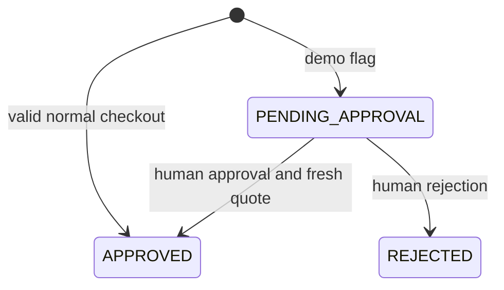

# Aimo agent approval demo

Node 22+ / Express monolith, PostgreSQL catalog and approval queue, and a local Node CLI with an Ollama adapter. Checkout is simulated locally: no real order is sent to Valio because the supplied OpenAPI contract has no checkout endpoint.

## Run

```sh
npm ci
cp .env.example .env
docker compose up -d db
npm run seed
npm start
```

In another terminal:

```sh
npm run cli -- agent --user-id customer-123 --preset normal-order
npm run cli -- agent --user-id customer-123 --preset suspicious-order
npm run cli -- approvals --user-id customer-123
```

The first preset is automatically `APPROVED`; the second is `PENDING_APPROVAL`. Enter `a` or `r` in the approval console, or use `approve ORDER_UUID` / `reject ORDER_UUID` with `--user-id`. `approvals --list-only` prints without prompting. Both presets select products `460000` and `460001` from the local catalog, with at least one sales unit rounded up to a valid lot size. In live mode these products might be unavailable; deterministic demos use `VALIO_MOCK=true`.

The workspace used during implementation has an ignored `.env` pointing to a temporary PostgreSQL instance at `127.0.0.1:55432`, database `aimo`, role `roni`. For a durable installation use the Compose volume and `.env.example` above. Source datasets are challenge-only, as stated in the supplied schema.

## Recipe agent

Run Ollama locally, pull a model (for example `ollama pull deepseek-r1:8b`), then:

```sh
npm run cli -- agent --user-id customer-123 --recipe "50 portions of creamy salmon soup" --date 2026-11-16
```

`OLLAMA_URL` and `OLLAMA_MODEL` select the local provider/model. The adapter first asks for ingredient search terms, searches the static catalog with five candidates per ingredient, then asks the model to select IDs and quantities using the returned package/unit information. If an ingredient has no results, it asks for up to three alternative names or Finnish translations and retries until a search matches. Only selected IDs are accepted. Missing search results after these retries, invalid model JSON, invalid quantities, or unavailable stock stop submission. Generated recipe carts always require approval; quantity conversion and ingredient suitability are not guaranteed by the model. Technical unit codes are not fully documented in the source data.

The CLI never receives the Valio API key or database credentials through the API. Its HTTP interface needs only `BACKEND_URL` and a customer ID. The model proposes structured data and cannot execute arbitrary tools. API identity comes from `X-User-Id` and is forwarded as Valio's `customer`.

## Live Valio mode

Set `VALIO_MOCK=false` and supply `VALIO_API_KEY` in `.env`, then restart the server. The default upstream is `https://junction26.valioaimo.fi`. The client sends JSON with `customer`, `requestedDate`, and `products` and authenticates with `X-API-Key`. Both wrappers enforce 1–1,000 distinct products, use a 15-second timeout, and surface upstream 429 responses without automatic retries. No catalog-wide price/stock refresh is performed. Mock mode must be explicitly enabled; it never silently substitutes for failed live calls. Mock quotes are visibly labeled and use EUR 2.50 per sales unit with synthetic stock.

## API contract

All endpoints except `/health` require `X-User-Id: CUSTOMER`. This is a **trusted localhost demo identity, not authentication**. The default listener is loopback. Before exposing this service, replace the header with authenticated identity and a separate human approver role; currently a caller who knows an ID can impersonate that user or approve their orders. The mock flagging rule is intentionally not a fraud detector or a rate-limit protection system.

| Method and path | Input / behavior |
| --- | --- |
| `GET /catalog/search` | Require `q`, `product_id`, or `category`. Optional `country`, `min_reliability`, `max_carbon`, `limit` (1–50). Returns products and a user-bound selection ID valid for 30 minutes. |
| `POST /api/price` | `{requestedDate, products, selection_ids}`; selected products only. Returns upstream fields plus `mocked`. |
| `POST /api/availability` | Same request shape and selection gate. |
| `POST /quotes` | Same request shape; fetches price and stock once each and persists a quote valid for 15 minutes. |
| `POST /orders` | Header `Idempotency-Key`; body `{quote_id, items:[{productId,quantity}], force_flag?:boolean}`. Uses only server-stored prices and catalog data. |
| `GET /orders` | Defaults to pending orders for this user. Supports `status`, `limit` (1–100), and `offset`. |
| `GET /orders/:id` | Retrieve this user's order. |
| `POST /orders/:id/approve` | Atomically approve a pending order with an unexpired quote. |
| `POST /orders/:id/reject` | Atomically reject a pending order. |

Example quote request after a catalog search:

```json
{
  "requestedDate": "2026-11-16",
  "products": ["460000"],
  "selection_ids": ["UUID-returned-by-catalog-search"]
}
```

Selections are persisted so an agent must narrow the catalog before a live call. Multiple searches can contribute to one quote. This gate does not prevent a malicious caller from repeatedly searching or querying; there is no production rate limiter in this demo.

`POST /orders` flags `force_flag=true`, header `X-Force-Flag: true`, more than 20 distinct order lines, or more than 20 total sales units. The latter is an intentionally simple demo threshold across heterogeneous units. Otherwise the order is approved immediately. Live queries themselves are not put into the order approval queue.



Pending means no simulated checkout completion. Approved means the monolith accepted the simulated order, not that Valio received or reserved it. Price/availability are quote snapshots rather than reservations. Approval checks quote freshness; expired pending orders can be rejected and a new quote submitted. Approval never reprices silently.

Idempotency is scoped by user and key. Concurrent retries of the same body return one order; different bodies with the same key return 409. CLI prints the exact body/key before submission for recovery. Re-running `agent` creates a new quote, so to retry a failed HTTP submission use that printed body and key directly. Concurrent opposite decisions allow only one transition. Repeating the same decision is idempotent. Order creation and decision events commit in the same transaction.

## Data and money

The actual supplied filenames are:

- `product_data.json`: 17,546 products; primary key is string `id`.
- `valio_aimo_junction26_product_data_schema.json`: source schema; quantities must be multiples of `allowedLotSize` in `salesUnit`.
- `valio_aimo_junction26_carbon_footprint.csv`: join `productId`, value `AVG kg CO2-eq/kg`; 11,033 catalog matches.
- `valio_aimo_junction26_delivery_reliability.csv`: join `productId`, value `deliveryReliability` (0–1); 4,425 matches.

`sql/schema.sql` defines catalog, selections, quotes, orders, and audit events. Seed uses one transaction with a database lock, batches upserts by product ID, and retains raw JSON for package/unit information. It can be rerun without duplicate products or affecting orders. Missing supplementary data remains null. Static searches use multilingual names and parameterized SQL; a simple substring scan is sufficient for this dataset. The seed updates/inserts supplied products; it does not delete records absent from later input files.

CO2 is **kg CO2-eq per kg of product**, not an order footprint. No total footprint is fabricated without reliable mass conversion. Reliability is a historical ratio, not guaranteed availability. Prices shown are per sales unit including tax. Line totals are rounded to cents and summed as integers; this demo does not calculate extra shipping or deposit charges. Blocked products, missing prices, insufficient quantities, passed cutoffs, wrong units, and delivery later than requested cannot be ordered.

## Verification

With PostgreSQL running and seeded:

```sh
npm test
```

Tests use real PostgreSQL and a temporary HTTP listener with mocked Valio responses. They cover joined data, selection enforcement, user scoping, quote expiry, lot sizes, payload tampering, idempotent concurrent submission, conflicting decisions, rejection, demo bulk flags, model adapter sequencing, upstream authentication, response failures, and API limits. Tests remove only their own generated data. Live Valio and an actual Ollama inference require the external services and are not part of the automated suite.

Source layout: `src/app.js` routes/search/quotes, `src/orders.js` checkout/state transitions, `src/valio.js` upstream adapter, `src/agent.js` local model adapter, `src/cli.js` agent and human interface, `scripts/seed.js` import.
